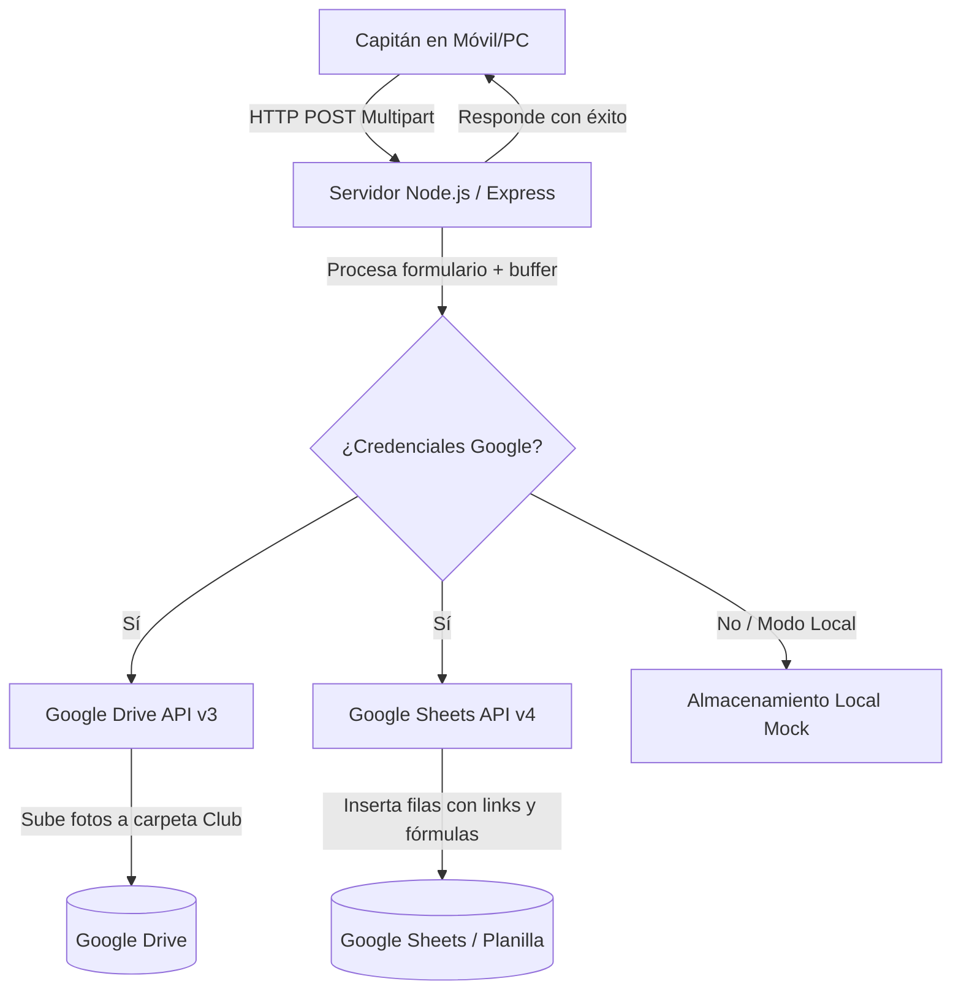

# Especificación de Diseño: Sistema de Registro de Futsal y Planilla en Google Drive

**Fecha:** 2026-11-07  
**Estado:** Aprobado / En ejecución  
**Proyecto:** `futsal-registro-planilla`

---

## 1. Resumen Ejecutivo
Una aplicación web completa y ligera diseñada para que los capitanes de equipos de futsal registren su club y la lista de jugadores (nombre completo, carnet de identidad CI y fotografía individual). La información se guarda y sincroniza automáticamente en **Google Drive** (organizando las fotos por carpetas de club) y en una **Planilla Google Sheets** compartida en vivo, con enlaces directos y fórmulas de visualización de fotos (`=IMAGE(...)`). La solución está optimizada para desplegarse fácilmente en servicios gratuitos como Render, Railway o en local con Node.js.

---

## 2. Requisitos y Alcance

### 2.1 Requisitos Funcionales
1. **Interfaz del Capitán (Web Móvil/Desktop):**
   - Campo para el nombre del Club / Equipo.
   - Lista dinámica de jugadores: botón para "+ Agregar Jugador" y botón para eliminar fila.
   - Por cada jugador: Nombre completo, Número de carnet (CI) y Carga de Foto (soporte de cámara en móvil o archivo).
   - Previsualización en tiempo real de cada fotografía cargada.
   - Compresión automática de imágenes en el cliente (Canvas) para optimizar tiempo de subida en redes móviles.
   - Validación antes del envío (al menos 1 jugador válido, campos obligatorios, fotos presentes).
   - Pantalla de confirmación con resumen de jugadores registrados.

2. **Backend & Integración con Google:**
   - Servidor Node.js con Express y `multer` para procesar formularios multipart en memoria (sin saturar disco).
   - Módulo de integración `google-drive-sheets.js` que utiliza `googleapis`:
     - Autenticación mediante **Google Service Account** (vía variables de entorno o archivo `credentials.json`).
     - Creación automática de la carpeta del Club dentro de la carpeta principal de Drive del campeonato.
     - Subida de fotos nombradas como `[CI]_[Nombre].jpg`.
     - Inserción de filas en la hoja de cálculo Google Sheets (`Fecha/Hora`, `Club`, `Nombre`, `CI`, `URL Foto en Drive`, `Fórmula Vista Previa`).
   - **Modo Offline / Local:** Si no se han configurado aún las credenciales de Google, la aplicación guarda las fotos en `public/uploads/` y genera un archivo CSV/JSON de respaldo, permitiendo probar y usar la app inmediatamente antes de vincular Google Cloud.

3. **Despliegue y Planilla ("Deployable"):**
   - Preparado para desplegar en Render (`render.yaml`), Railway o Vercel con un solo clic.
   - Dockerfile para despliegue en cualquier contenedor.
   - Script de autocheck / salud (`/api/health`) para verificar conexión con Google Drive y Google Sheets.

---

## 3. Arquitectura del Sistema



---

## 4. Estructura de Archivos del Proyecto

```
futsal-registro-planilla/
├── package.json
├── server.js
├── .env.example
├── Dockerfile
├── render.yaml
├── README.md
├── src/
│   ├── googleService.js      # Lógica de Google Drive y Sheets API
│   └── validator.js          # Validaciones de entrada
├── public/
│   ├── index.html            # Interfaz de registro para capitanes
│   ├── css/
│   │   └── styles.css        # Estilos modernos y responsivos
│   └── js/
│       └── app.js            # Lógica de cliente, previsualización y compresión
└── test/
    └── server.test.js        # Pruebas automatizadas de la API
```

---

## 5. Estrategia de Pruebas y Verificación
1. **Pruebas Unitarias/Integración:** Tests con Node.js `assert` verificando endpoints `/api/health`, `/api/register` con mocks de subida.
2. **Prueba End-to-End Local:** Simular un registro de club con 3 jugadores y fotos válidas, verificando la respuesta JSON y el almacenamiento.
3. **Validación de Configuración:** Documentar paso a paso cómo obtener las credenciales de Google Cloud gratis y configurar la carpeta de Drive y Google Sheet.
